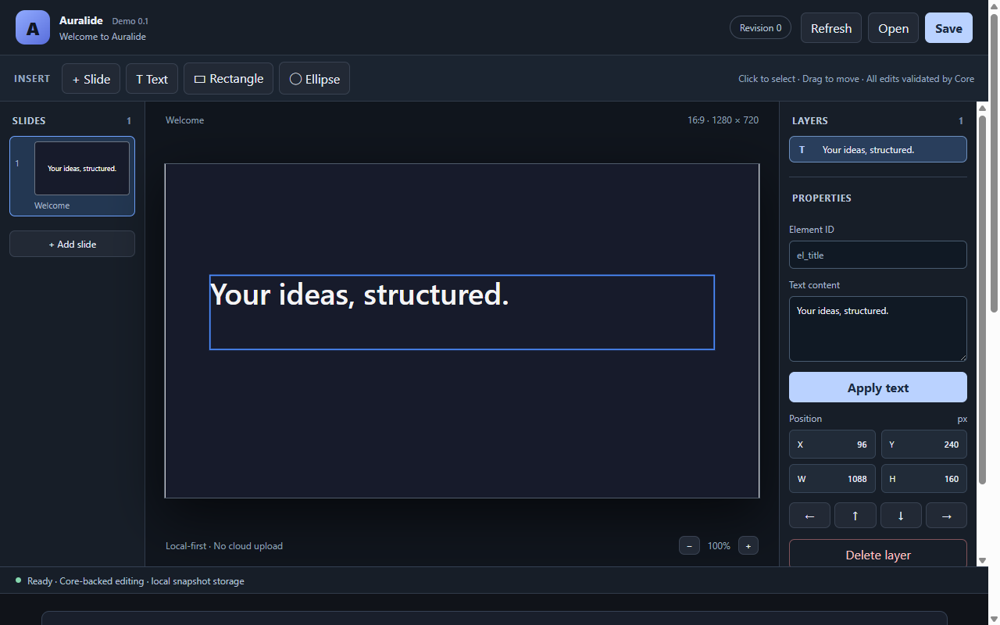
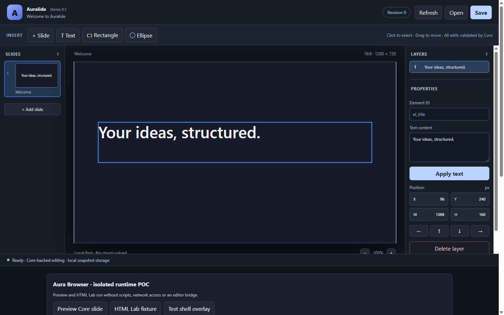
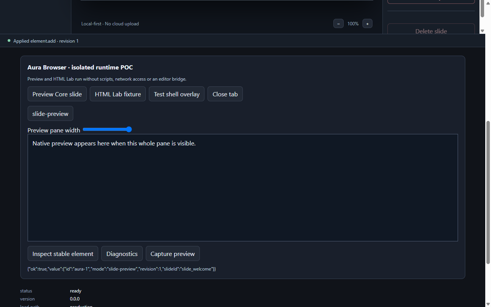
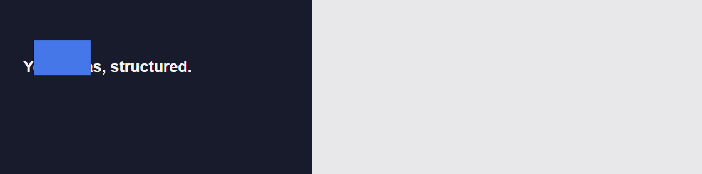

# Desktop Demo 0.1 — 实际 UI 审计

基线：PR #24 精确提交 `8891a983ec6adbff8ff05a99845ca89b4a08f0b7`。本轮从该提交建立独立工作树、构建生产模式并在真实 Windows x64 Electron 44.7.2 运行。未使用旧工作树的未提交 UI 修改作为最终基线证据。

结论：**工程功能原型可运行，产品 UI 不通过**。与 [Issue #26](https://github.com/Jimqiu1003/auralide/issues/26) 的拒收方向一致；CI、构建与安全 smoke 不能证明编辑体验合格。

## 实际证据

Shell 捕获不包含原生 guest 的完整合成输出；下面是通过现有 `preview.screenshot` 单独捕获的 guest PNG。不能把前图空框当成预览没有生成，也不能把后图当成布局已经合格。

在两个内容区尺寸均捕获了初始、选中文本、选中形状和 Aura。完整状态截图及机器结果见 `apps/desktop/test-artifacts/demo-v02-design/`。截图测试只在临时内存会话插入一个矩形，没有写入用户文档。

| 测量          | 1280×800   | 1440×900   |
| ------------- | ---------- | ---------- |
| 整页内容高度  | 1598px     | 1598px     |
| Editor 高度   | 760px      | 760px      |
| Aura 区域起始 | y=782px    | y=782px    |
| 画布实际尺寸  | 763×429.19 | 923×519.19 |

## 按优先级的问题清单

| 优先级 / 问题                     | 证据与用户影响                                                                                         | Demo 0.2 验收条件                                                          |
| --------------------------------- | ------------------------------------------------------------------------------------------------------ | -------------------------------------------------------------------------- |
| **P0 / 工作区纵向堆叠**           | renderer 顶层依次放置 DocumentPreview、AuraPoc、facts、probes；整页 1598px，1280×800 首屏几乎没有 Aura | 用命名工作区替换中央内容，Editor/Aura 不纵向叠放；两种窗口无整页滚动       |
| **P0 / 开发诊断暴露给普通用户**   | Aura POC、版本、bridge、IPC ping 和原始 JSON 出现在普通页面                                            | 用户界面只保留可理解反馈，开发诊断保持独立、明确入口；不靠删除安全测试解决 |
| **P1 / 画布布局由固定高度约束**   | 1440×900 下 Editor 仍为 760px，侧栏与画布比例缺少统一窗口模型                                          | Shell 填满内容区，侧栏内部滚动，默认 16:9 画布在1280窗口达到至少720×405    |
| **P1 / 属性设计以实现细节为中心** | Element ID、revision 和 Core 技术说明显著；形状面板只有位置数值和“未来支持”说明                        | 文本/形状上下文属性、单位和应用反馈优先；技术 ID 只在有用的检查入口呈现    |
| **P1 / 直接操作不完整**           | 源码已有插入、选择、移动，但无实际缩放/样式命令和 UI；文本主要依靠侧栏 Apply                           | 正式阶段通过唯一 Dispatcher 补能力；本轮原型仅验证交互设计，并明确标注模拟 |
| **P1 / 历史和文件反馈不成熟**     | UI 无 Undo/Redo；常显 Save 未表达完整脏状态；保存/重开消息偏技术                                       | 显式未保存/保存中/成功/取消/失败/冲突与草稿保留；会话历史边界清楚          |
| **P1 / 图层和缩略图不足**         | 图层为基础线性按钮；缩略图只摘要文字而非完整图形内容；对象选择主要 pointer 事件                        | 全内容缩略图、稳定选中反馈、键盘替代、多选与上下文属性；不虚构分组树能力   |
| **P1 / 键盘路径不完整**           | 画布 SVG group 没有对象级 tabindex/键盘激活；移动依靠拖拽或箭头按钮                                    | 对象与图层可键盘选择、焦点可见；输入框原生按键与文档快捷键明确区分         |
| **P2 / 缺少系统性视觉语言**       | 深色主题、文字图标、技术提示、边框和控件层级混合；长期使用需要过多扫描                                 | 统一 semantic token、控件密度、图标、间距和字体层级，明暗主题独立检查      |
| **P2 / 打包早于视觉验收**         | #24/#25 均有工程 CI 与运行声明，但明确没有负责人视觉接受记录                                           | 保持 Draft；三套可操作方案完成比较与负责人选择后再实施正式 UI              |

以上源码路径主要为 `apps/desktop/src/renderer/main.tsx`、`document-preview.tsx`、`aura-poc.tsx`、`styles.css`。问题描述基于本轮观察，不把未运行的 macOS、屏幕阅读器或混合 DPI 行为写成缺陷结论。

## 保留的工程资产

保留 Electron/React/TypeScript、结构化文档、Schema 校验、唯一 Dispatcher、revision 冲突检测、P2A 保存重开，以及 Aura WebContentsView 隔离和权限拒绝。UI 重构不授权修改这些边界，也不授权合并前置 PR。

后续方案、截图、能力边界与验证见[三方案设计评审](demo-v02-design-review.md)。
