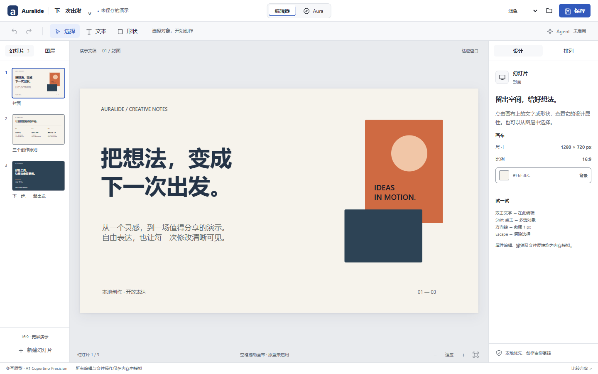
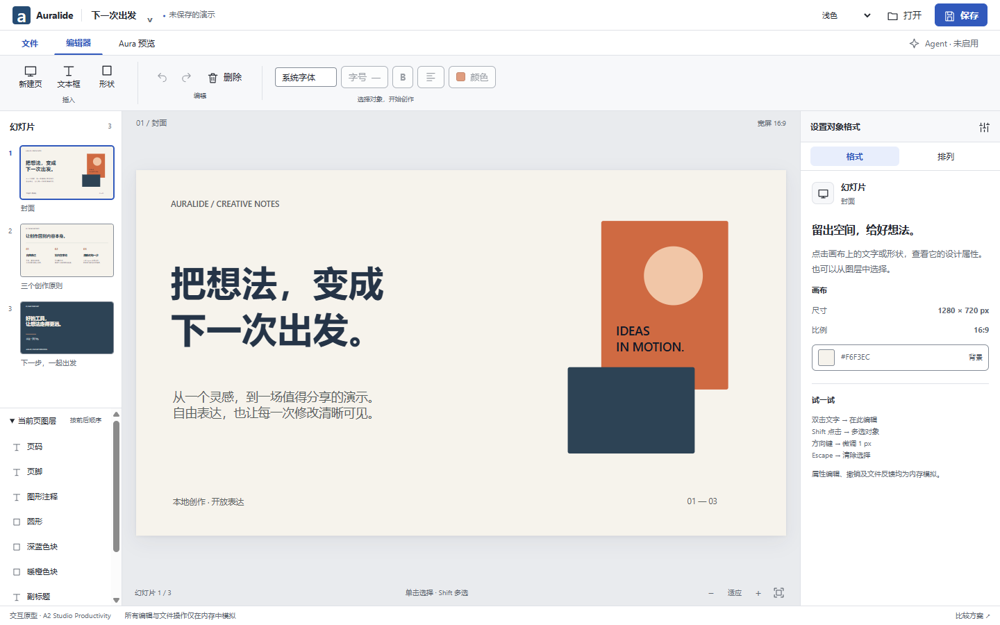
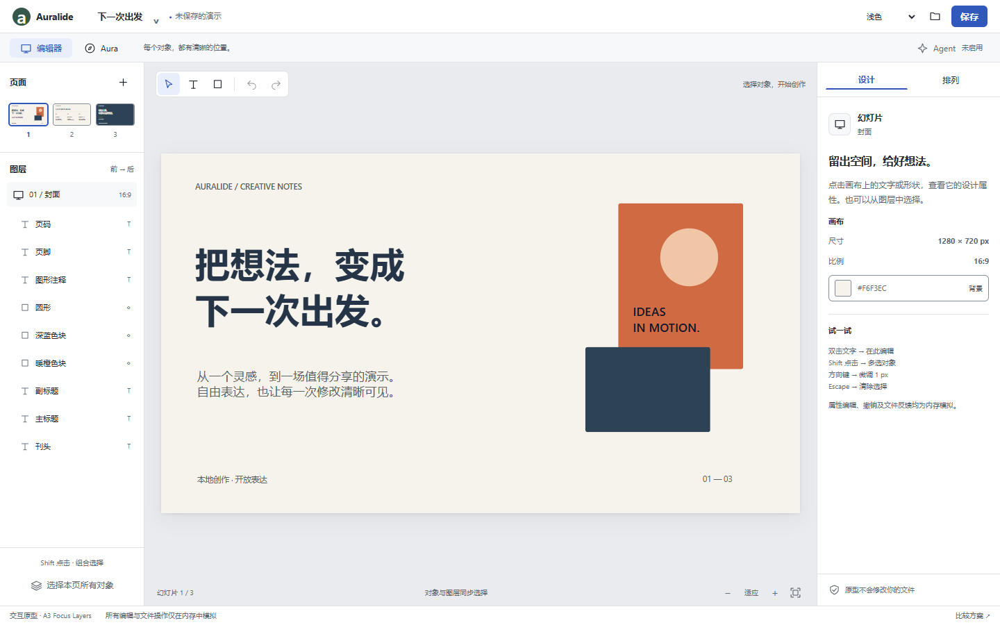

# Desktop Demo 0.2 — 三方案设计评审

状态：**负责人已于 2026-10-17 选定 A2 · Studio Productivity**。视觉主方向已确定；正式 Demo 0.2 实施尚未开始，不代表功能或发布验收通过。

任务：[Issue #26](https://github.com/Jimqiu1003/auralide/issues/26)。基线：[PR #24](https://github.com/Jimqiu1003/auralide/pull/24)，精确提交 `8891a983ec6adbff8ff05a99845ca89b4a08f0b7`。

## 打开与比较

打开[比较入口](../design/demo-v02/index.html)，或直接打开 [A1](../design/demo-v02/a1.html)、[A2](../design/demo-v02/a2.html)、[A3](../design/demo-v02/a3.html)。保留整个 `demo-v02` 文件夹即可离线运行，无服务器、构建步骤或新增依赖。每个入口能单独运行，不依赖比较页。

所有方案采用负责人已选定的 **Canvas-first + Stable Panels**：左侧幻灯片/图层、中央画布、右侧属性检查器；Aura 替换中央区域，切回保留选择。三套主体 HTML 各自编写，共享演示数据、模拟行为、图标与基础 token。所有截图来自真实 Electron 渲染，不是生成式设计效果图。

### A1 — Cupertino Precision



- 单行紧凑工具栏，顶栏工作区切换；左栏用分页切换幻灯片和图层，右侧精简属性分组。没有仿制 macOS 红绿灯或品牌资产。
- 优势：画布最大、视觉安静、控制位置稳定，适合反复修改内容和长时间创作。
- 成本：查看图层需要一次左栏切换；较复杂的功能需要依靠上下文和菜单渐进呈现。
- 维护复杂度：三者中最低。后续 Agent 审查可进入右侧命名面板，沿用相同选择与文档上下文。

### A2 — Studio Productivity



- 文档顶栏、工作区导航与分组工具栏；常用插入和编辑动作直接可见，上下文格式工具随对象类型启用。左侧幻灯片和可折叠图层区同时存在，右侧对象格式面板。
- 优势：中文标签明确，常用操作可发现性最好；熟悉办公软件的用户迁移成本较低。
- 成本：顶栏占 160px，视觉密度最高；1280×800 时左栏两个区域需要内部滚动。图层多时查找不如 A3。
- 维护复杂度：最高。工具栏与 Inspector 重复暴露部分格式操作，未来需要保持启用状态、验证和快捷键一致。Agent 入口清晰，但须避免变成不断扩张的功能区。

### A3 — Focus Layers



- 左栏顶部紧凑页面概览，下方常驻完整对象列表；工具集中在画布顶部。对象与图层双向同步，右侧设计/排列标签稳定。
- 优势：对象结构最清楚，图层选择无需切换；适合多对象构图、组合选择及未来 Agent 对象范围审查。
- 成本：缩略图较小，不利于浏览很长的演示；左栏更宽，默认画布最小。图层列表目前是平面对象顺序，不虚构分组树能力。
- 维护复杂度：中等。后续若加入真实分组树，需要独立的导航、命令和辅助技术契约。

## 负责人决定：以 A2 为正式主方向

负责人明确选择 **A2 · Studio Productivity**。后续正式 Shell 沿用 A2 的文档顶栏、工作区导航、分组工具栏、左侧幻灯片/可折叠图层区与右侧上下文格式面板，继续遵守 Canvas-first + Stable Panels。

A1/A3 保留为比较材料，不作为并列实施方向。A2 工具栏与 Inspector 应共用相同的命令、启用条件与验证，避免两套操作状态漂移；中文标签与常用动作可达性是该方向的设计重点。

该选择确定视觉主方向，没有新增对原型每项细节、真实文件行为、Agent 授权或双平台原生体验的验收结论。本次只记录选择，正式编辑器仍按后续阶段实施。

这些优缺点和使用成本是设计判断及操作步骤分析，尚无用户任务时间、成功率或偏好研究数据。

| 默认 16:9 画布 | 1280×800 内容区 | 1440×900 内容区 |
| -------------- | --------------- | --------------- |
| Demo 0.1 基线  | 763×429.19      | 923×519.19      |
| A1             | **800×450**     | **960×540**     |
| A2             | 776×436.5       | 936×526.5       |
| A3             | 760×427.5       | 920×517.5       |

三方案没有整页滚动；侧栏需要时独立滚动。尺寸为 Electron 内容区 CSS px，不含操作系统原生标题栏，不将它等同于物理屏幕或混合 DPI 的验收。

## 核心操作评审流程

1. 在左栏切到第二页，再回封面，确认缩略图与画布内容相同。
2. 点击主标题，在 Inspector 修改文字、字重、字号、颜色或对齐，点击「应用设计修改」。双击文字可把焦点送到内容字段。
3. 点击橙色形状，切换「排列」，修改宽高并应用；也可拖动对象，或聚焦对象后用方向键微调。尺寸手柄仅示意，不宣称拖拽缩放已经实现。
4. Shift 点击另一个对象进行多选；从图层点击对象，验证选择边框与属性一致。A1 先切左栏「图层」。
5. 点击保存，在明确的模拟对话框中选择正常、失败或冲突。正常结果只创建内存快照；失败/冲突保留画布和未应用属性草稿，不自动重试。
6. 再编辑后打开快照，明确选择放弃模拟修改或取消。重新读取冲突快照同样需要明确的替换动作。
7. 切换 Aura，比较当前页与 HTML Lab；返回编辑器，确认页面和选择保留。
8. 切换明暗/跟随系统，检查主题只影响编辑器。尝试 Tab、Enter、Shift+Enter、Escape、方向键及文档快捷键。

Ctrl / Cmd + S 为模拟保存，Ctrl / Cmd + O 为模拟打开，Ctrl / Cmd + Z 为模拟撤销，Ctrl + Y / Cmd + Shift + Z 为重做。输入框保留原生编辑行为；原型没有改动生产快捷键。

## 能力边界

- 所有文档编辑、历史、保存、打开和冲突均为内存模拟，刷新丢失。未应用的属性输入以页面/对象为键保留，保存只包含已应用内容，并有明确提示。
- 无 `window.auralide`、真实 Core/Dispatcher、文件对话框、磁盘写入、后端、Agent 提案或 Apply。未来正式文档编辑必须继续通过唯一 Dispatcher，携带稳定 ID 与 expectedRevision。
- Aura 原型使用无权限 sandbox iframe，并有禁止脚本/联网的 CSP；不加载用户 HTML 或远端页面。正式 WebContentsView 生命周期、DIP 坐标、原生覆盖层、guest 焦点和权限仍按 ADR-0004 实现与测试。
- 无 PPTX、通用 HTML 导入、真实演示播放、导出或发行包；不覆盖现有实现，不改 Core、IPC、preload、存储、安全配置或 lockfile。

## 验证与证据

[机器检查结果](../design/demo-v02/evidence/results.json)记录真实环境、基线尺寸、12 个布局组合和 67 组检查。完整截图留在忽略目录 `apps/desktop/test-artifacts/demo-v02-design/`；精简评审截图提交在 `docs/design/demo-v02/evidence/`。

| 项目         | 本轮结果                                                                                     |
| ------------ | -------------------------------------------------------------------------------------------- |
| 真实环境     | Windows x64，Node 24.21.0，Electron 44.7.2 / x64                                             |
| #24 精确基线 | 两种尺寸的初始、文本、形状、Aura Shell，以及单独原生 guest PNG 已捕获                        |
| 原型矩阵     | 3 方案 × 2 尺寸 × Light/Dark；每组捕获 Editor/Text/Shape/Aura/Save/Open                      |
| 布局与空间   | 无整页横纵滚动、无侧栏重叠、无水平溢出的控件；默认画布均 ≥720×405                            |
| 交互         | 切页、真实内容缩略图、对象/图层同步、多选、属性、尺寸校验、撤销重做、保存/失败/冲突/重开通过 |
| 键盘与草稿   | Aura/删除/菜单返回焦点、属性跨标签/工作区保留、空数字草稿保留、主题选择 Escape 不丢草稿通过  |
| 主题与对比   | System 动态跟随、减少动态偏好、正文/控件 token 对比和预置内容关键颜色通过                    |
| 控制台与网络 | 原型无 pageerror / console error，无 HTTP(S) 请求                                            |
| 项目验证     | `pnpm verify` 通过；未变包复用 Turborepo 缓存，Desktop 16 项单测本轮实际执行                 |
| 补充静态检查 | 独立原型 JS ESLint 和 Git whitespace 检查通过                                                |
| 未执行       | 本轮 macOS ARM64 原生、真实屏幕阅读器、强制颜色、125%/150% 和混合 DPI 验收                   |

独立无障碍审查使用 `keyboard-navigator`、`modal-specialist`、`forms-specialist`、`aria-specialist`、`alt-text-headings`、`live-region-controller`、`contrast-master`。审查为静态复核；真实键盘路径由主任务 Electron 回归覆盖，不等于屏幕阅读器认证。技能的独立报告 schema/渲染器本机缺失，因此采用本报告记录发现与修复，没有声称生成其标准报告。

首轮发现并修正：橙底小字对比不足（修复后 4.894:1）、原则编号颜色（4.819:1）、深色/橙色背景上的焦点与选框、选中工作区标记、Aura 和删除后的焦点、嵌套对话框的返回焦点、属性导航草稿丢失，以及主题框 Escape 意外撤回草稿。选框现有深浅双层描边并保持缩放后线宽。

初版测试还发现形状中心点被上层圆形覆盖，已按可见区域点击验证；属性提交失焦时的 change 事件会重新写入草稿，已修复；主题切换截图曾捕获到过渡中间帧，现等待动画完成。逐张检查截图时发现一张 A3 Aura 内容尚未加载，测试已改为等待 iframe 中的实际 SVG 并验证正文，再截图。完整 85 张通过联系表逐张检查，并对代表状态查看原尺寸。首次 `verify` 的证据 JSON 格式及新增测试浏览器全局声明问题均已修复后重跑。

复现（仓库根目录，先完成锁定依赖安装）：

```powershell
pnpm build
node apps/desktop/test/demo-design.electron.mjs
pnpm exec eslint docs/design/demo-v02/prototype.js
pnpm verify
git diff --check
```

加 `--evidence` 会明确更新已提交的精简截图与结果；默认仅写忽略的测试目录。测试启动自有 Electron profile，结束退出该测试应用；不会保存用户文档。

## 后续实施与选择门禁

1. **视觉选择：已完成**：负责人于 2026-10-17 明确选择 A2；具体密度、中文可读性及交互细节仍需正式实现时验证。
2. **产品 Shell**：以 A2 为主方向替换正式 renderer，隔离开发诊断入口；验证原生菜单、窗口与工作区生命周期。
3. **直接编辑与历史**：将尺寸/样式等实际能力补入同一验证 Dispatcher，再接文本、拖拽、缩放、Undo/Redo 及快捷键。不能复制原型内存模拟逻辑为生产文档旁路。
4. **持久化与 Aura**：连接真实脏状态、取消、冲突恢复、原生预览边界和焦点；Agent 入口保持未启用直到真实授权与审查服务实现。
5. **双平台验收**：Windows x64 / 原生 macOS ARM64，现有安全/持久化 smoke，加视觉、键盘、真实屏幕阅读器和五分钟人工任务验收，再考虑打包。

分支：`feat/demo-v02-design`；工作树：`Auralide Worktrees/feat-demo-v02-design`；Draft PR 目标：`feat/demo-v01-workspace`，Refs #26。前置 #19–#25 均保留原状态。提交 SHA 与最终 Draft PR URL 由 Git/PR 记录及本次交付消息提供，避免在报告内维护自引用 SHA。
