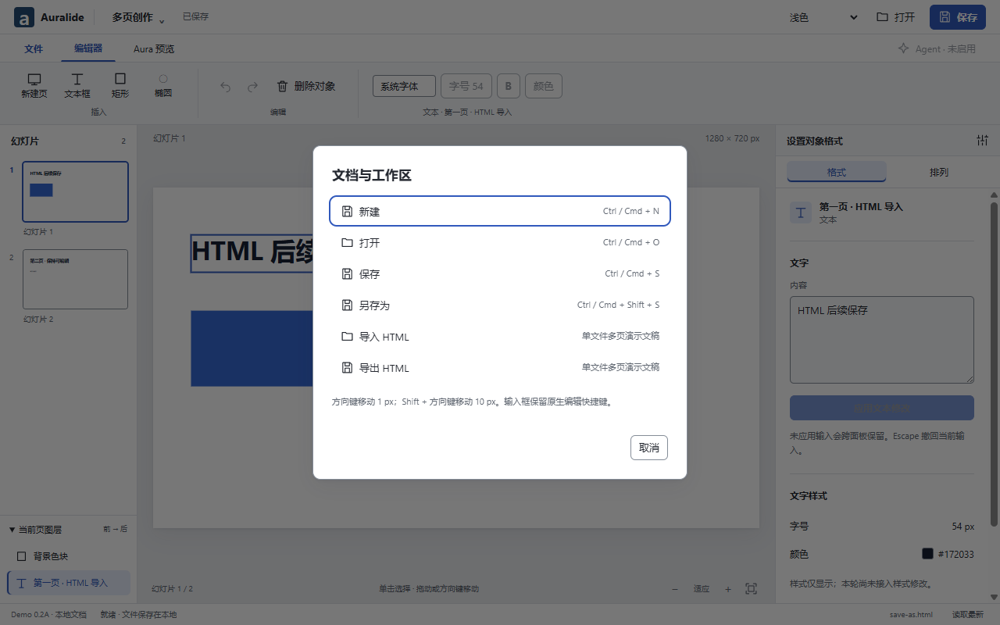
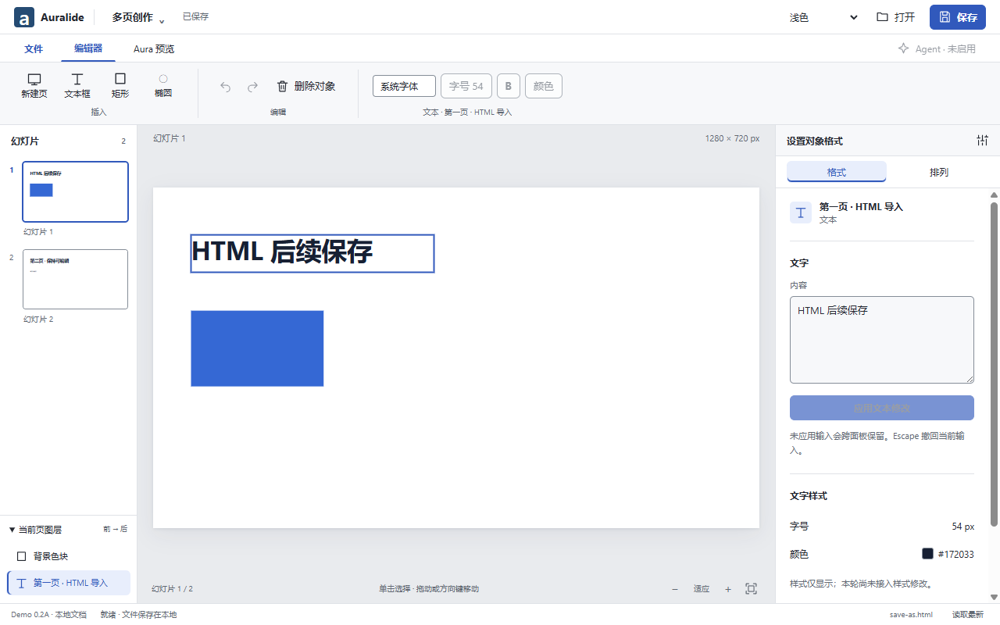
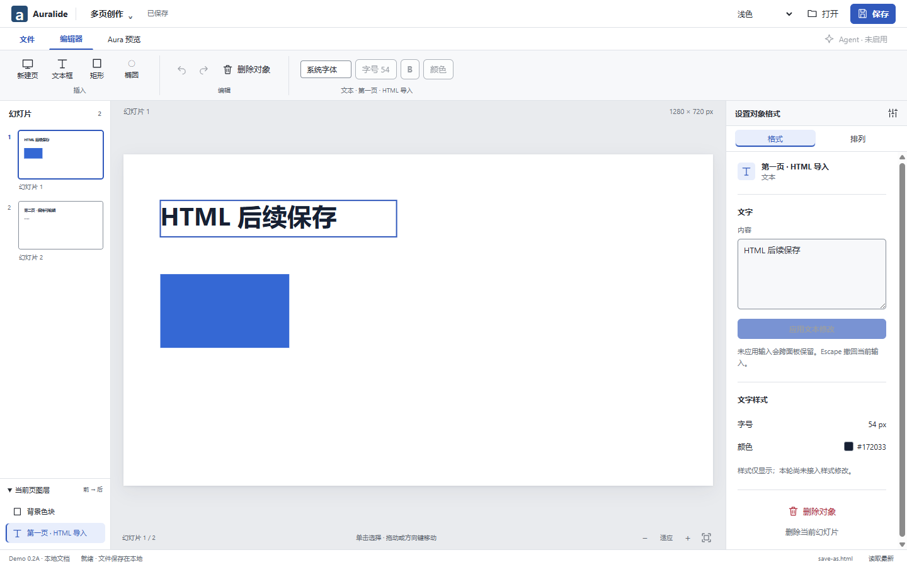

# Demo 0.2A — files and multi-slide HTML

Status: implemented file slice; platform CI pending. Builds on Draft #28 (`ba5d378`), targets
`feat/demo-v02-shell`, refs #26. No main merge, predecessor merge or user worktree overwrite.

## Actual behavior

The A2 file menu now offers New, Open, Save, Save As, Import HTML and Export HTML. Open accepts JSON,
HTML and HTM. Ctrl/Cmd+N, O, S and Shift+S invoke the same named, revision-only IPC operations.
Native dialogs own all file grants. The bridge is 1.5.0; it exposes no generic filesystem/JS API.

New produces a blank 16:9 slide through Core and asks before discarding unsaved work. Save writes
the active binding; Save As always opens a chooser, changes the binding only on success, and supports
JSON or standalone HTML. Export HTML writes a derived snapshot and preserves dirty state/binding.
Same-path Save As retains the old fingerprint, so it cannot bypass external-edit conflict rejection.
The existing bounded UTF-8 reader, atomic writer and recovery backups are reused for both formats.

Ordinary static single-file decks convert measured text and basic shapes into editable Core objects.
Recognized page markers include `.slide`, `data-slide`, `data-slide-id` and direct body sections.
Each detected page, including initially hidden pages, is inspected. A native loss-confirmation dialog
precedes application; the original source and conversion mappings are retained by source hash.
Converted imports start unsaved and unbound. Auralide-generated HTML embeds escaped native metadata
for structural round trips; subsequent Save regenerates HTML from Core, never by editing its DOM.

Imported HTML is untrusted. Its inspection guest has a separate nonpersistent Session, no preload,
Node, scripts or resource permissions; CSP and request interception block network/subresources.
Aura continues to use its existing WebContentsView and native-document preview. The standalone
export player contains fixed navigation code; that code does not execute during import or in Aura.

## Evidence and checks

Executed locally on Windows x64:

| Check                                 | Result                                                  |
| ------------------------------------- | ------------------------------------------------------- |
| `pnpm verify`                         | PASS: format, lint, types, unit tests, production build |
| Production/development Electron smoke | 167/167 PASS                                            |
| Existing durable-file suite           | 22/22 PASS                                              |
| Existing A2 shell suite               | 49/49 PASS                                              |
| New real Electron file suite          | 40/40 PASS                                              |

The new suite uses isolated profiles and temporary documents, with only native user choices stubbed.
It covers multi-page HTML, loss refusal, script/Node/bridge isolation, provenance, Core editing,
disk save, actual window close and new application process, reopen HTML, native Aura entry,
offline player navigation, Save As cancellation/failure/external conflict, dirty/binding rules,
New/discard, exact CSS viewport sizes and draft-modal focus restoration.

These are actual Electron renderer captures, not full native-window composites. Both sizes have no
whole-page scrolling. The existing A2 suite covers both themes, System, panels, selection and native
Aura separately. The imported fixture is intentionally sparse to expose text/shape geometry.

Failures repaired: TypeScript branded IDs and Electron event overloads; an unsafe modal-content focus
gap identified by keyboard review; old test button locators after confirmation wording changed;
a negative test that incorrectly treated inert script source text as executed DOM mutation. Each
affected flow was rerun successfully. The keyboard reviewer performed static review; the new suite
then verified actual cancel focus and Escape restoration.

## Limits and remaining work

- This is a bounded static HTML converter, not a general browser-to-slide fidelity engine. Embedded
  CSS is measured, but external styles/fonts, image bytes, videos, charts, SVG paths, scripts, complex
  layouts, animation and nested presentation-framework semantics are not preserved faithfully.
  Conversion warns before application; users should compare all imported pages with their source.
- Auralide metadata preserves supported structured content; it does not package unresolved image
  assets or preserve an arbitrary imported file's original formatting on subsequent HTML Save.
- Common font/paragraph editing, UI undo/redo and in-app presentation remain separate work. Existing
  disabled controls are not made functional by this file slice. Phone remote, screen recording,
  rehearsal and countdown are deferred by the owner. Export playback is not an in-app slideshow.
- Plugin extensibility is recorded as Proposed in `docs/design/ui-architecture.md`: contributions,
  capability boundaries, disposal and failure recovery. No plugin manager/runtime or marketplace
  exists yet, and no Cordis dependency or third-party code execution was introduced.
- Native macOS ARM64 CI for this exact commit is pending. Manual screen-reader, mixed-DPI, packaged
  application and arbitrary external HTML fidelity validation have not been performed.

## Run and review

In this worktree: `pnpm install --frozen-lockfile`, `pnpm build`, then
`pnpm --filter @auralide/desktop start`. Use File → Import HTML for a UTF-8 single-file deck, inspect
the loss report, edit text, Save As JSON/HTML, close, reopen and enter Aura. The generated HTML also
opens directly in a browser and supports previous/next and arrow-key navigation.

The next vertical slice should add common editing and basic presentation through the same validated
Core path, followed by a versioned extension contract and one bundled adapter. A2 remains the default.
