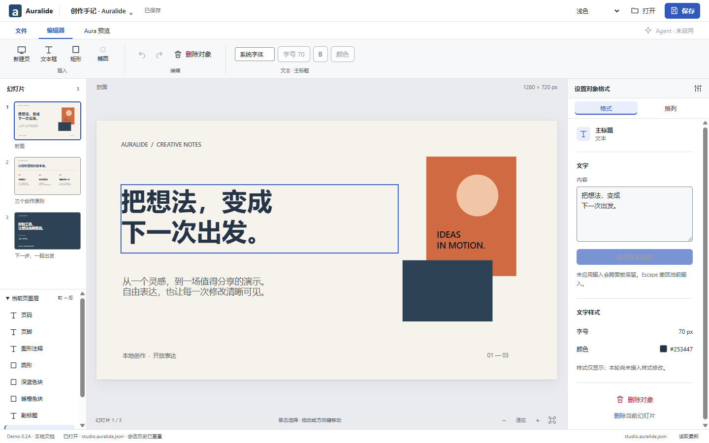
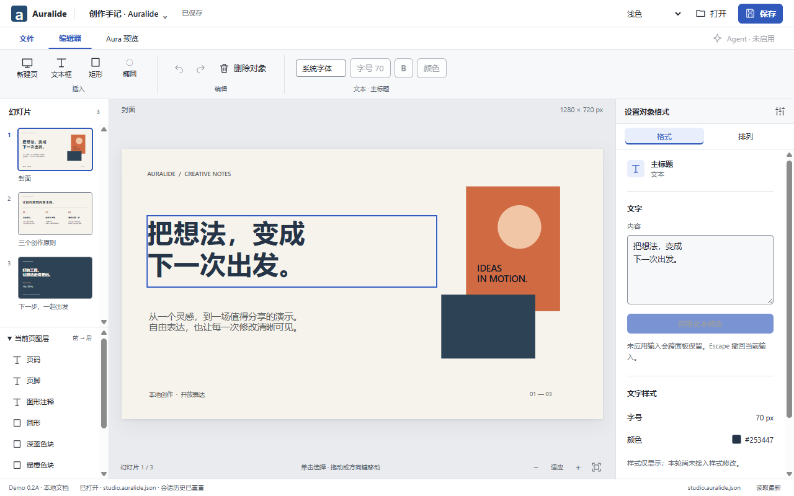
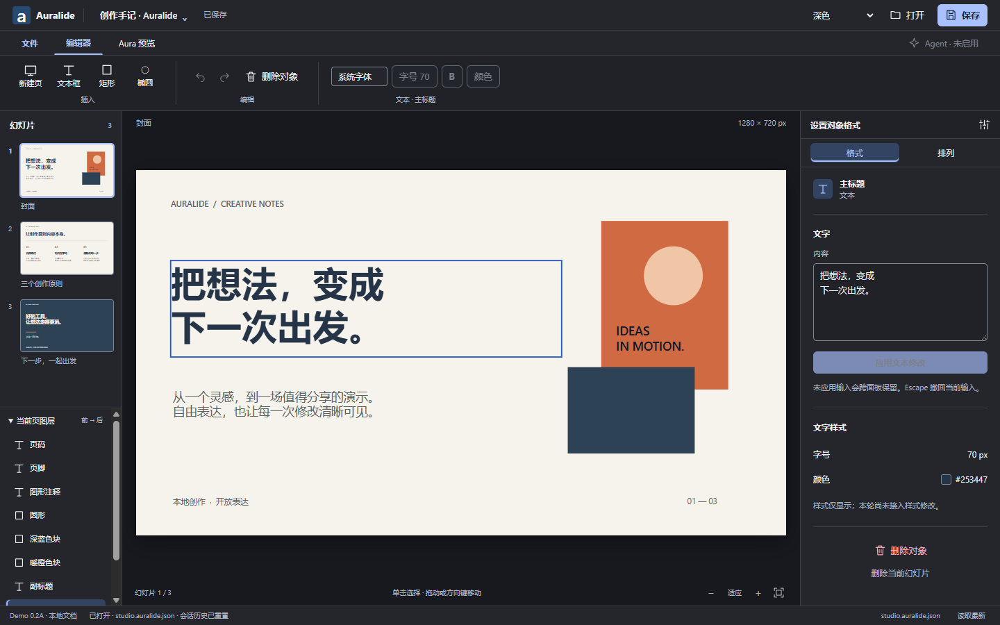
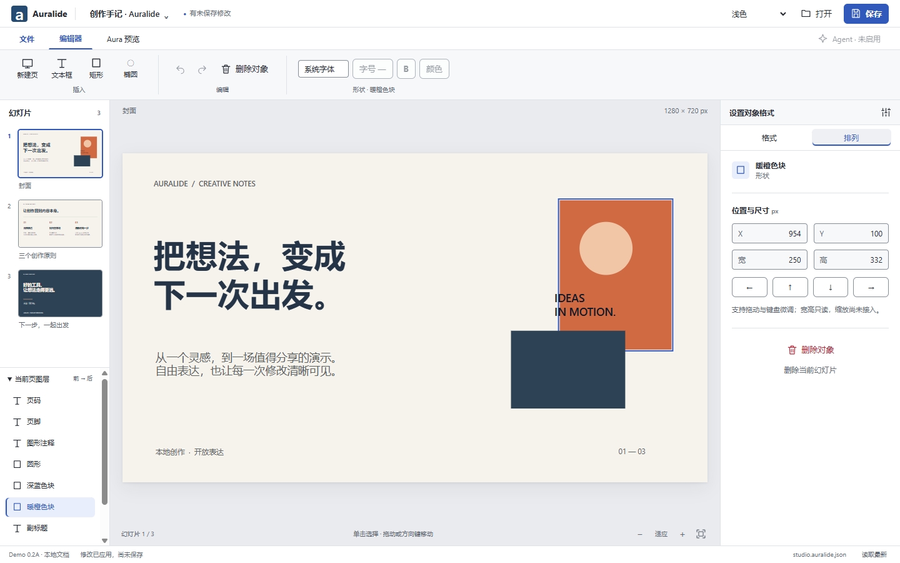
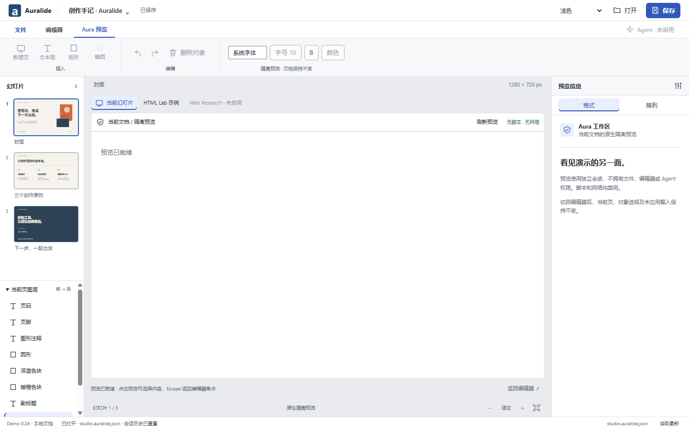
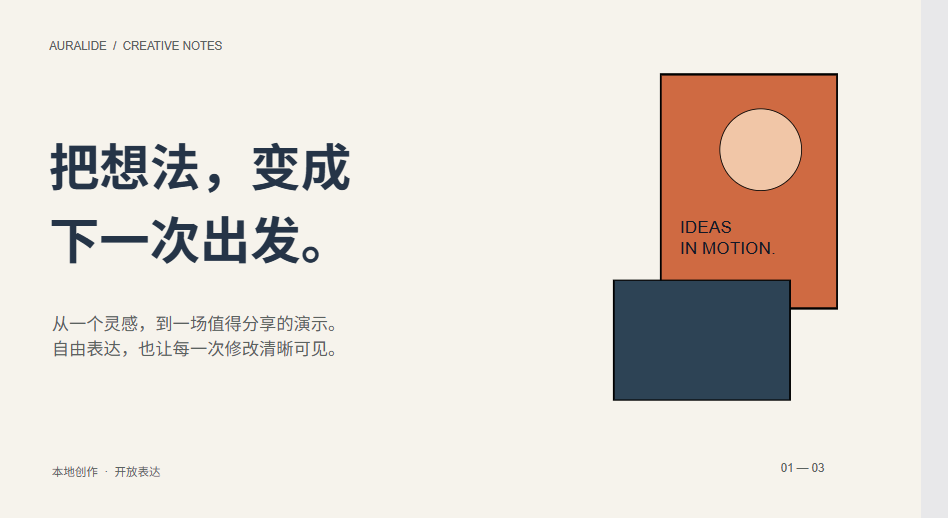

# Desktop Demo 0.2A — A2 正式 Shell 集成

日期：2026-10-17。分支：`feat/demo-v02-shell`。状态：Windows 本地门禁通过，远端双平台 CI 待本分支提交后执行；仍为 Draft，不自动合并。

## 基线与边界

独立工作树 `Auralide Worktrees/feat-demo-v02-shell` 基于 PR #27 精确提交
`6cd50998147b32447a59b9a5b7d27d825e14dd72`；PR 叠放在 `feat/demo-v02-design`。
#27 基于 #24 `8891a983`，包含 #23 持久化依赖。现有 #19–#25 及 #27 不合并、不改写。
既有工作树及 Demo 0.1 的未提交修改保留。本分支不从 `prototype.js` 引入任何状态/文件模拟逻辑。

生产沿用六项 Core 编辑操作、严格 IPC、expectedRevision、Schema 和 P2A 原子保存/指纹冲突拒绝。
只新增主进程只读 `getDocumentStatus`（revision、dirty、文件 basename），不开放路径或文件能力。
Bridge 1.4.0 同步 preload、API、主进程和边界测试；Core 命令及文档格式不变。

## A2 视觉与操作结果

| A2 基线项目                                   | 正式实现与差异                                                                       |
| --------------------------------------------- | ------------------------------------------------------------------------------------ |
| 44px 标题栏、36px 工作区导航、80px 分组工具栏 | 保持结构；保存状态来自主进程，不是原型内存快照                                       |
| 176px 左栏、288px Inspector、中央画布         | 保持比例；两尺寸默认画布分别为 776×436.5、936×526.5 CSS px，无整页滚动               |
| 三页真实内容缩略图及可折叠图层                | 读取实际 Presentation Document，以相同 SVG 内容绘制缩略图；图层按前→后显示           |
| 文本、形状的上下文操作                        | 支持真实文本应用和位置修改；字重/颜色/尺寸/历史操作明确禁用或只读                    |
| 选择与属性同步                                | 画布、图层同步；双击文字聚焦 Inspector；方向键 1px/Shift 10px；修改后保留焦点        |
| 明暗和 System                                 | 编辑器主题变化，幻灯片内容颜色保持；焦点深浅双描边，选中标签有独立标记               |
| Editor/Aura 往返                              | 保留页、对象、文本草稿；原生 WebContentsView 替换中央工作区，无 iframe               |
| 反馈与开发工具                                | 原始 JSON、IPC 探针、POC 控件移至明确的诊断 fragment；普通菜单无入口、正常启动不渲染 |

A2 原型用同一套版式内容进行公平对照；例稿转换为 Core Schema 验证的静态 JSON，正常使用原生打开。
原型的多选、模拟 Undo/Redo、样式和缩放编辑未当成真实能力迁入。没有自动保存、最近文件自动恢复或真实 Agent Apply。

## 交互依据

本轮应用项目 `auralide-ui-engineer` / `aura-browser-engineer`，并用 `interface-design`、
`interaction-design` 及 `accessibility-lead` 检查界面。用户已有 A2 选择保持有效，无新增视觉审批门槛。

- [Apple HIG — Toolbars](https://developer.apple.com/design/human-interface-guidelines/toolbars)：导航与编辑动作分开、常用操作稳定可达；采用安静的表面、分组与焦点反馈。
- [PowerPoint 键盘编辑](https://support.microsoft.com/en-us/accessibility/powerpoint/use-keyboard-shortcuts-to-create-powerpoint-presentations) 与 [对象选择](https://support.microsoft.com/en-gb/powerpoint/select-individual-objects-on-a-slide)：图层提供遮挡对象的替代选择路径，编辑保留键盘连续操作。
- [Canva 图层](https://www.canva.com/en_in/help/finding-and-arranging-layers/)：使对象身份、选择与属性容易对应；本轮没有冒充已支持图层重排/锁定。
- [Slides 编辑器分区](https://slides.com/docs/editor-overview)：稳定分区围绕内容编辑，开发能力作为明确的次级入口。

这是对工作原则的参考，不复制品牌、图标资产或整套界面。Auralide 的特征是本地文档状态与隔离预览共享稳定的页/对象上下文。

## 实际核心流程

1. `pnpm build` 后 `pnpm --filter @auralide/desktop start`。
2. 直接使用欢迎页，或点击「打开」选择 `docs/examples/studio-notes.auralide.json` 的副本。
3. 切页，点击画布文字或图层；右侧修改文字并应用。拖动对象或用方向键移动；排列页也有精确的 10px 按钮。
4. 保存；待提交文本会先明确确认应用，文件路径由系统对话框选择。取消/失败/冲突时保留当前文档与输入。
5. 关闭程序，重新启动，再打开保存的文件，看到相同内容。
6. 切到 Aura 预览当前页，返回后继续原对象编辑。Agent、样式、尺寸和文档 Undo/Redo 不可用。

## 数据与原生边界

未应用文本在 renderer 草稿 Map 中按稳定 ID 保留；它不是持久化文档。保存前明确应用，每一次通过
Dispatcher。文件打开仅成功后才清草稿。原生关闭保护已应用未保存内容；beforeunload 额外保护未应用文本。
冲突不静默重试、不覆盖外部修改；读取最新仅刷新主进程快照，不自动重开磁盘文件。

原生 Aura 使用独立非持久会话、无 preload/Node/编辑桥、无脚本/网络。切回编辑器、shell 模态框及文件操作
先隐藏 guest；DOM 测量经已有 bounds IPC 处理；Escape 将 guest 焦点返回 host。

以下两张分别是 CDP 的 shell 表面和原生 guest 的真实 PNG；CDP 不包含兄弟 WebContentsView，未伪称整窗截图：

## 验证记录

- `pnpm verify`：PASS，format/lint/typecheck/unit tests/build；未改包的 Turbo 结果可能命中缓存。
- Electron production + development smoke：167/167 PASS，保留原有 IPC、CSP、隔离、guest 生命周期拒绝路径。
- Persistence Electron：22/22 PASS，真实磁盘、恢复备份、关闭/重启/重开及 HTML guest。
- A2 正式 Shell Electron：48/48 PASS，2 尺寸 × Light/Dark，System 跟随；保存取消、实际文件系统失败、精确外部字节冲突保护、草稿跨 Aura、原生模态覆盖和 Escape、键盘焦点及真实进程重启。
- [机器记录](demo-v02-shell-evidence/shell.json)。运行方式：`node apps/desktop/test/shell.electron.mjs`。
- 三个无障碍专项静态检查：修复焦点恢复、可见标题的可访问名称、输入说明关联和选中标记。正文/次级文字最小对比度分别 Light 12.37/4.64、Dark 8.57/4.64；焦点最小 5.35/6.20。任意文稿色不计为 Shell 对比度保证。专项报告器 schema 不存在，采用回退 JSON；不宣称屏幕阅读器验收。

实际发现与修正：首次键盘应用后回退焦点落到画布，改为优先文本输入；旧测试依赖原英文反馈和诊断首屏，已显式选择诊断路由并改为真实 A2 状态；冲突测试从换行数推断改为精确字节对照。相关检查均重跑通过。

## 后续限制

macOS ARM64 新提交 CI 尚待执行并回填；本机无法人工验证 macOS 原生键盘/对话框。
屏幕阅读器、混合/物理 DPI 和强制颜色模式未验证。HTML guest 与编辑 SVG 的默认字形、形状描边仍沿用各自既有 renderer 行为；不把 Shell 交付等同完整 WYSIWYG 一致性验收。
生产 Undo/Redo、样式、对象缩放及 Agent 授权仍是后续阶段，不在本轮伪造实现。

## 新提交 CI 修正记录

首轮 [39011549287](https://github.com/Jimqiu1003/auralide/actions/runs/39011549287)：两平台安全 smoke 通过，
重启后立即捕获原生 guest 失败。测试改为有界等待可捕获帧，保留超时后的真实拒绝；不重试文档写操作。
同时隔离测试 profile，避免本机已有用户窗口影响测试或反过来干扰它。

第二轮 [39012532012](https://github.com/Jimqiu1003/auralide/actions/runs/39012532012)：Windows 全部通过，
macOS ARM64 安全及 22 项持久化通过；A2 尺寸检查观察到请求 1280×800、实际内容 1280×672。
视觉测试单独使用 [Electron enableLargerThanScreen](https://www.electronjs.org/docs/latest/api/base-window)
的未打包专用参数 `--auralide-visual-test`，正常启动保留 OS 约束。测试等待并断言实际 CSS 尺寸，
记录 display/workArea/scale。它证明真实 Electron/WCV 的目标布局，不证明小物理屏幕能完整显示超出屏幕的窗口。

React Doctor 82/100：无 error；两个旧 Aura POC 警告、output 的冗余 role 提示，以及编辑器组件规模/复杂度提示。
本轮不为评分重写命令与文件会话；组件后续可按面板抽取，属于已记录维护成本。未向项目安装 Doctor 依赖。

Windows 整窗 Computer Use 工具授权超时，未获得其截图；报告保留明确分开的真实 shell 与 guest PNG，未合成或冒充原生整窗。
